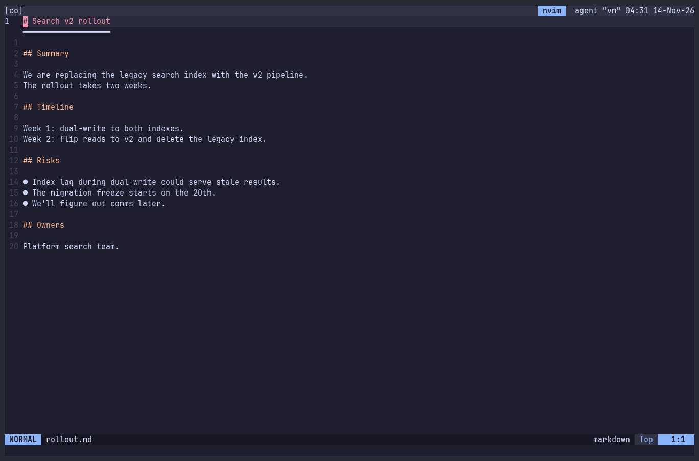

# Coauthor threads — design record

Status: **design, not implemented.** All open questions are decided; ready for
implementation.

## Goal

Leave comments on a document without touching it, submit them to Copilot or
Claude in one go, and have the agent edit the document and/or reply. Each
comment is a conversation thread that can go back and forth.

Builds on the AI clipboard bridge (`<leader>ay`), which already produces the
anchor (`@path:start-end` + text).



The recording above is a scripted mockup: real Neovim, with a Lua stand-in for
the Rust CLI and a script standing in for the agent's file edits.

Terms:

- **Anchor text:** the commented lines stored with a thread (the `>` lines),
  used to re-find the thread after the document changes.
- **Review baseline:** a copy of the whole document taken at submit, used only
  as the base of the review diff.

## Decided

### Architecture: the `coauthor` CLI owns the threads

- Comments live in a **threads file**, never in the document. Inline comments
  are accident-prone and need cleanup.
- A Rust CLI, `coauthor`, is the **only writer** of threads files. Neovim and
  the agent both use it; neither edits a threads file directly.
  - Neovim calls it asynchronously with `vim.system` and parses its `--json`
    output. Neovim has no threads-file parser of its own.
  - The agent calls it from its shell tool.
- The agent edits the **document** with its normal file tools. The CLI never
  touches the document; it only reads it to re-find anchors.
- Crate lives in this repo (`coauthor/`), built and installed by `make deps`
  (`cargo install --path coauthor --locked`, toolchain pinned by `mise.toml`),
  and tested in CI on all three platforms. A candidate to move to its own repo
  later.
- When the binary is missing, the Neovim side disables itself with one notice
  instead of erroring.
- Docs: a README in the crate for humans. Agents need nothing more: `coauthor
  list` prints the agent rules and `coauthor --help` the commands. No skill.

### Storage

- Threads files live in the state directory, outside every repository:
  `$XDG_STATE_HOME/coauthor/` (default `~/.local/state/coauthor/`) on
  Linux/macOS, `%LOCALAPPDATA%\coauthor\` on Windows.
- One file per document, keyed by the document's canonical absolute path, e.g.
  `rollout.md-1a2b3c4d.threads.md`; the header records the full path.
- No repository footprint and no ignore rules.
- Consequences:
  - Moving or renaming a document detaches its threads; `coauthor mv OLD NEW`
    re-keys them. `coauthor prune` deletes threads files whose document no
    longer exists.
  - Each worktree has its own threads (different absolute paths).
  - `coauthor path DOC` prints the file, for inspection.
- A sandboxed agent shell may be unable to write outside the project; see
  The agent's permissions.

### Threads file format

Markdown with a strict, dumb shape, so it stays readable via `coauthor path`.
Only the CLI writes it.

```markdown
<!-- coauthor v1 · written by the coauthor CLI; do not edit by hand
doc: /home/me/src/project/docs/rollout.md
round: open -->

## t1 · lines 12-14
> The rollout takes two weeks.

**me:** too vague, give phases

**ai:** {edited 12-18} Split into 3 phases.

**me:** why 3 and not 2?

**ai:** {no edit} Phase 2 has the migration freeze; merging it with 1 hides that dependency.
```

- Threads are conversations. Any number of turns; a doc edit is an optional
  side effect of an AI turn, not the point of it.
- Reply tags: `{edited L-L[, L-L]}` or `{no edit}`. Braces, because
  render-markdown conceals square-bracket link syntax.
- Messages are append-only, so a message's position is its stable id (`t2.3`).
- Only the CLI assigns thread ids.

### Status is derived, not stored

| Last message | Status |
|---|---|
| `**me:**` | awaiting ai |
| `**ai:**` | awaiting me |
| — | `resolved` (only stored status; set by the user) |

### CLI commands

Every command takes the document path. `--json` gives machine output (Neovim
always uses it); the default is readable markdown.

Agent-facing:

| Command | Effect |
|---|---|
| `coauthor list DOC [--awaiting ai\|me]` | Agent rules, then the threads. The agent's entry point. Read-only: it reports re-found anchors but never saves them, because mid-round the document may be half-edited |
| `coauthor reply DOC ID --edited 6,10-12 TEXT` | AI reply that changed the doc |
| `coauthor reply DOC ID --no-edit TEXT` | AI reply without a doc change |
| `coauthor move DOC ID A-B` | Re-anchor; saved immediately. Fails if the range doesn't exist; takes the anchor text from the doc itself |
| `coauthor done DOC` | Ends the round: re-finds every anchor in the now-final document and saves the results |

Neovim-facing (also usable by hand):

| Command | Effect |
|---|---|
| `coauthor comment DOC --lines A-B --anchor-text TEXT MESSAGE` | New thread. Neovim passes the anchor text from the buffer: mid-round, or with unsaved edits, the file on disk is not what the user selected |
| `coauthor comment DOC --thread ID TEXT` | User reply |
| `coauthor resolve DOC ID` | Mark resolved |
| `coauthor sync DOC --anchors JSON` | Write current extmark positions |
| `coauthor round DOC open` | Start a round |
| `coauthor path DOC` / `mv OLD NEW` / `rm DOC` / `prune` | Housekeeping |

Agent rules printed by `coauthor list`:

```
- Reply to every thread awaiting ai with `coauthor reply`. Editing the document
  is optional: answer with --no-edit when the comment is a question or you
  disagree.
- Edit the document with your normal file tools. Never edit threads files.
- If your edit moves or rewrites a thread's anchored text, run `coauthor move`.
- When you are finished, run `coauthor done DOC`.
```

### Concurrency

- Every CLI write is a read-modify-write under an exclusive advisory lock on
  the threads file, followed by write-to-temp and rename, so a reader never
  sees a half-written file.
- Neovim and the agent both go through the CLI, so their writes serialize.
  Because messages are append-only and ids come from the CLI, concurrent
  comments and replies never conflict.

### The agent's permissions

The agent needs shell access to `coauthor` only. Headless submit grants Edit on
the document plus that one command:

| Agent | Allow only `coauthor` |
|---|---|
| Claude Code | `--allowedTools "Bash(coauthor *)"` (or a `permissions.allow` entry). A compound command such as `coauthor … && rm …` still prompts: every subcommand must match. |
| Copilot CLI | `--allow-tool 'shell(coauthor:*)'` |

Sandboxing: Claude Code's sandbox is off by default. When it is on, sandboxed
commands may write only to the working directory, a temp directory and added
directories, so the state directory needs
`sandbox.filesystem.allowWrite: ["~/.local/state/coauthor"]`, and on Linux the
directory must already exist (`coauthor` creates it on first run from Neovim).
Copilot CLI's sandboxing behaviour is unverified.

### Submit

1. `:w` the document (required: otherwise the agent edits a stale file and the
   reload hits W12).
2. `coauthor sync` the current anchor positions.
3. `coauthor round DOC open`.
4. Save a copy of the document to `stdpath('state')` as the review baseline.
5. Yank a short prompt:
   ```
   Address the open comment threads on @docs/rollout.md: run
   `coauthor list docs/rollout.md` and follow its instructions.
   ```

Only threads awaiting ai are in scope.

**Experimental:** headless submit runs the agent CLI non-interactively with the
same contract and the permissions above.

### Rounds

A round runs from submit until the agent finishes.

**Start:** submit opens the round, then hard-locks the document buffer:
`nomodifiable` and `readonly`. `readonly` matters too: a `:w` of an unmodified
buffer would still overwrite the agent's edits.

**During the round:**

- The document is the agent's.
- Threads stay live for both sides: comments and replies from Neovim go
  straight through the CLI, and agent replies show up as they land. No queue.
- The document is not reloaded and anchors are not resolved until the round
  ends, so a half-finished agent edit cannot produce fake orphans.

**End**, whichever comes first:

- `coauthor done` (the threads file's `round:` turns `done`),
- the headless agent process exits,
- `:CoauthorDone`, the manual fallback when the agent forgets.

A headless exit and `:CoauthorDone` both run `coauthor done` themselves, so
anchors are always re-found and saved at round end.

`:CoauthorCancel` ends the round without waiting (and kills a headless agent).

**On end:** unlock the buffer, reload the document, load the anchors `coauthor
done` saved, notify once.

Known gap: an agent document write arriving after the round ended is handled as
an unsolicited update (reload and notify). If the buffer has unsaved edits at
that point, Neovim's built-in W12 prompt is the only guard.

### Review

`<leader>td` opens a native `diffthis` against the review baseline. Gitsigns
diffs against the index, which is the wrong baseline for uncommitted documents.
The reload is undoable as one step (`'undoreload'`).

### Anchoring and re-anchoring

Each thread stores `lines` plus its anchor text (`>`). After every document
reload, each thread walks a resolution ladder:

| # | Check | Result |
|---|---|---|
| 1 | text at stored `lines` matches the anchor text | `anchored` |
| 2 | exact anchor text found elsewhere | `anchored`, `lines` updated. Multiple matches: nearest, marked `drifted` |
| 3 | fuzzy match within ±N lines | `drifted` above threshold — **experimental, off by default** |
| 4 | nothing | `orphaned`, keeping last-known line and anchor text |

- The ladder runs in the CLI (`coauthor list --json` reports each thread's
  resolved state), so Neovim and the agent see the same anchors.
- While the document is open, extmarks track anchors; their positions are
  synced on `:w` and before submit.
- `drifted` is more dangerous than `orphaned`: it can sit on the wrong paragraph
  silently. It stays unconfirmed until accepted.
- Fuzzy matching ships off. A false orphan costs one re-anchor; a false drift
  misattaches a comment silently.
- Any thread can be re-anchored, not just orphans:
  - From the document: visual select → `<leader>tr` → fzf-lua picker (orphaned,
    then drifted, then the rest).
  - From the side split: `r` on a thread → jump to document → select → `<CR>`.
- Re-anchoring replaces the anchor text; the old one is kept as a `was:` line until
  the thread is resolved.
- When re-anchoring an orphan whose last AI reply carries `{edited L-L}`, the
  picker pre-selects that range as the suggestion. The agent often says where
  the text went even when it forgets to run `coauthor move`. Nothing moves until
  the user confirms.
- An orphan is always shown as `was line N`, never as sitting at line N: after
  edits, line N may belong to another thread.

When moved anchors are saved:

| Who moved the text | Source of the new position | Saved |
|---|---|---|
| The user, in Neovim | extmarks (exact) | on `:w` and before submit (`coauthor sync`) |
| The user confirming a re-anchor | the selected lines | immediately (`coauthor move`) |
| The agent, with `coauthor move` | the range it names | immediately |
| The agent's edit, found by the ladder | text search | at round end (`coauthor done`) |

### Orphan discoverability

Many orphans are not failures: the agent removed the text because it addressed
the comment. Triage is re-anchor, resolve, or ignore.

| Surface | Behaviour | Default |
|---|---|---|
| `mini.notify` | every round: "3 replies · 1 edit · 1 orphaned" | on |
| Side split | pinned **Needs anchor** section at the top with `was:` anchor text | on |
| Lualine | `awaiting me 2 · awaiting ai 1 · orphan 1`, foreground only, coauthor buffers only | on |
| Quickfix | `[orphan] t3 · was line 17: <anchor text>` at last-known line | on |
| In-buffer eol | dim `· orphan t3` at last-known line | **off** |

### Thread views

Both, to compare in use:

- **Side split** — the cursor's thread, plus the **Needs anchor** section. Keys:
  `<CR>` jump, `r` re-anchor, `a` accept drift, `x` resolve.
- **Float** — the thread under the cursor. *Experimental.*

Anchored lines are marked in the document (option B from the mockup):

- The line number is coloured by whose turn it is (peach: awaiting me, blue:
  awaiting ai). Foreground only, no signs, so gitsigns keeps the sign column.
- A dim thread id (`t1`) as end-of-line virtual text on the first anchored line,
  so quickfix and side-split entries can be matched at a glance.

### Scope and toggle

- Any filetype.
- `:Coauthor` toggles the workflow for the current buffer.
- Auto-enabled for `markdown`, and for any file that already has threads
  (checked asynchronously with `coauthor path DOC`), so toggling once persists
  without extra state.

### Keymaps (proposed)

`<leader>ar` and `<leader>ax` are taken by the review-context panes, so
coauthor uses the free `<leader>t` (threads) prefix.

| Key | Action |
|---|---|
| `<leader>tc` | comment on line/selection (new thread, or reply inside one) |
| `<leader>tt` | open thread under cursor (side split) |
| `<leader>tf` | open thread under cursor (float) *(experimental)* |
| `]t` / `[t` | next / previous thread |
| `<leader>tl` | threads → quickfix |
| `<leader>ts` | `:w`, review baseline, open round, yank submit prompt |
| `<leader>tS` | headless submit *(experimental)* |
| `<leader>td` | diff against the review baseline |
| `<leader>tr` | re-anchor (visual) |
| `<leader>tx` | resolve thread |

### Experimental features

Experimental keymaps get an `(experimental)` suffix in `desc` so which-key shows
it, and a cheatsheet section lists them. Initially: headless submit, float view,
fuzzy drift matching.

### Change detection

- `vim.uv.new_fs_event` on the **directories** holding the document and its
  threads file, filtered by name. A per-file watch dies when a save replaces the
  file by rename, which Neovim itself does by default (`'backupcopy'` is
  `auto`, which renames plain files), and which the CLI does on every write.
- Events are debounced. A threads-file change refreshes the views; a document
  change outside a round triggers `:checktime` and anchor resolution.
- An event is ignored when the threads file matches the state Neovim's own last
  CLI call returned.
- `FocusGained` → `:checktime` as a fallback for a missed event.

## Findings from the mockups

### Second mockup (final design, recording above)

1. **Anchor text for a new comment must come from the buffer.** Mid-round, the
   agent had already rewritten the file on disk, so line 21 on disk was not the
   text the user selected. *Decided:* Neovim passes the anchor text
   (`--anchor-text`).
2. **Anchors re-found after the agent's edit were never saved.** `list` computed
   t2 → 17 and t4 → 22 but only reported them. *Decided:* `list` stays
   read-only; `coauthor done` saves them (see When moved anchors are saved).
3. **The thread colour is lost on the cursor line**, because the cursor-line
   number highlight wins. Accepted: the side split shows that thread anyway.

### First mockup

A scripted mockup (real Neovim 0.12 with catppuccin, mini.notify, lualine and
render-markdown configured like this repo) surfaced these; each is now decided.

1. **Commented lines are hard to see.** With no signs or virtual text, nothing
   in the document marks an anchored line; only the side split reveals it when
   the cursor lands there. *Decided:* coloured line numbers plus an
   end-of-line thread id (see Thread views).
2. **render-markdown conceals the `[edited 18]` tag brackets** (treated as a
   shortcut link), in both the side split and the raw sidecar. That breaks the
   "keep source characters visible" rule. *Decided:* tags use braces,
   `{edited 18}` / `{no edit}`, which markdown leaves alone.
3. **The file watcher sees Neovim's own sidecar writes.** The mock ignores an
   event when the file content equals what Neovim last wrote. *Decided:* see
   Change detection.
4. **Watching the document file breaks on rename-based saves.** A save that
   writes a temp file and renames it (Neovim's `backupcopy=no`, and possibly
   agent edit tools) invalidates a per-file watch handle. The mock needed
   `backupcopy=yes` and watched only the sidecar. *Decided:* watch the
   directory (see Change detection).
5. **An orphan's last-known line can be another thread's line.** t3 orphaned at
   line 17, where t2 is anchored, so both quickfix entries point at line 17.
   The agent's reply on t3 said `{edited 18}`, the right new location.
   *Decided:* label orphans `was line N`, and suggest the reply's edited range
   when re-anchoring (see Anchoring and re-anchoring).
6. **mini.notify's top-right popup covers the top of the side split**, which is
   where the "Needs anchor" section lives. *Decided:* keep notify every round;
   the overlap lasts a few seconds.

The mock's re-anchor picker was the built-in `vim.ui.select`; the design keeps
fzf-lua.

## Alternatives considered

### Agent edits the threads file directly

The original design: a `<file>.threads.md` next to the document, agent rules in
its header, the agent editing it with file tools. Replaced by the CLI because
agents could break the format, Neovim had to queue its own writes during a
round, and the round's end depended on the agent editing a header marker.

### Merge-friendly threads file

Adopted through the CLI. Messages are append-only, ids come from one place, and
status is derived, so serialized CLI writes never conflict. This is what removed
the round queue.

### CRDT

Rejected. A CRDT avoids conflicts only when every writer emits operations
through it; the agent rewrites the document with its edit tools, so its changes
could only enter as snapshot diffs, which is a three-way merge with extra
machinery. For prose, a CRDT resolves concurrent edits by silently
interleaving them, where the hard lock produces no conflicts at all. No Lua CRDT
library was found; Ethersync (Automerge-based, with a Neovim plugin) needs an
external daemon.

### Database

Rejected. Agents cannot edit a database with file tools, Neovim has no built-in
SQLite, and a native library dependency is painful on Windows. The CLI gives
the same validation with a readable file.

### MCP server

Not needed. The CLI works with any agent that has a shell; an MCP server could
wrap the same commands later if an agent without shell access needs them.
